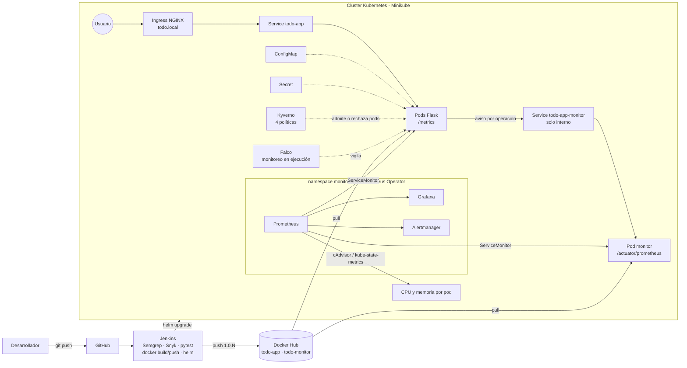
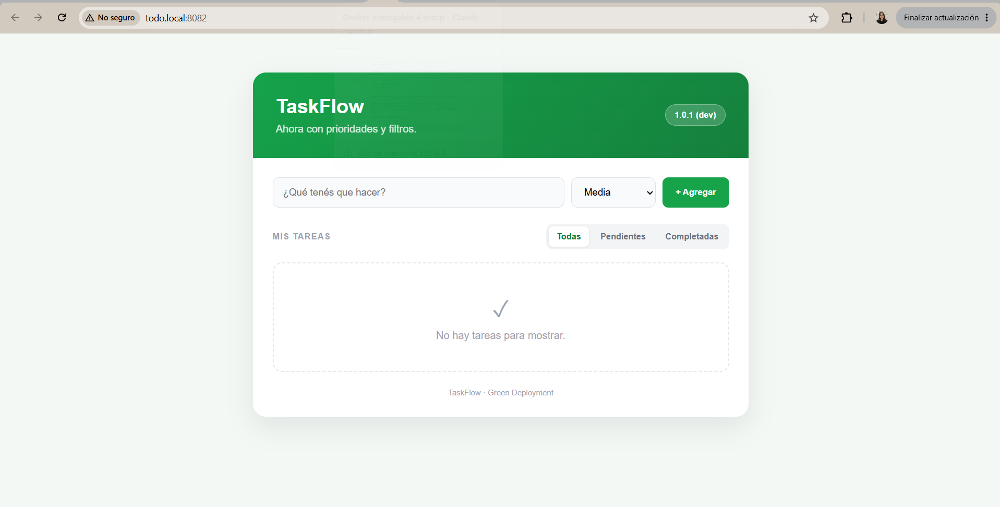
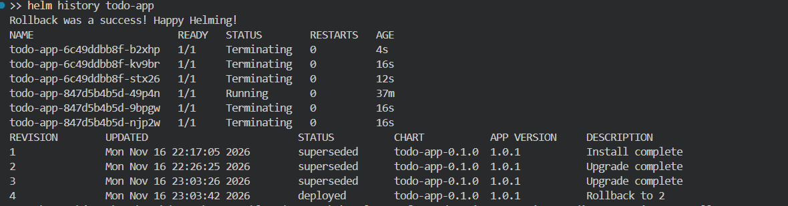
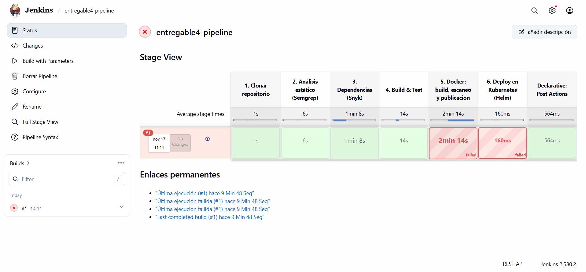
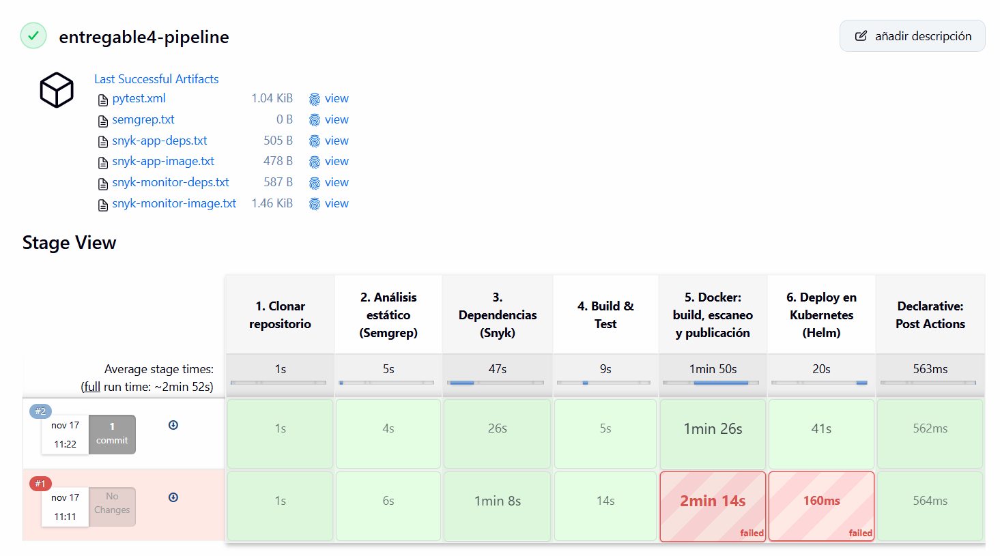
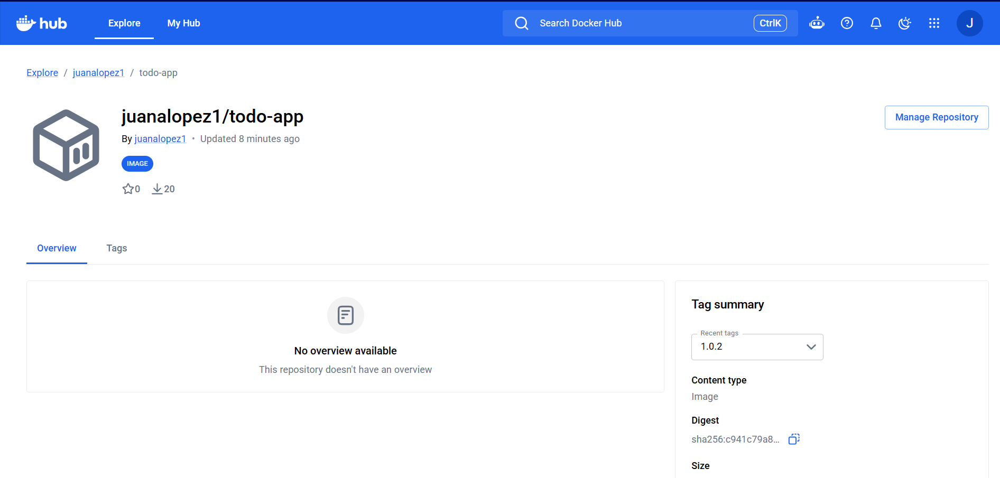
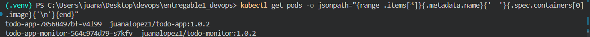
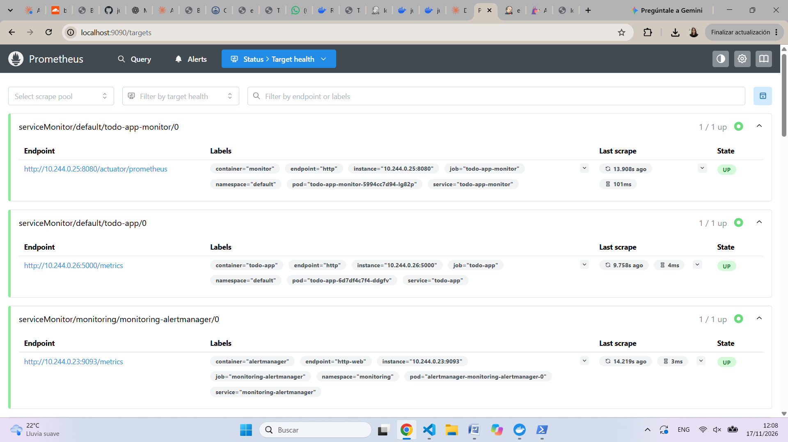
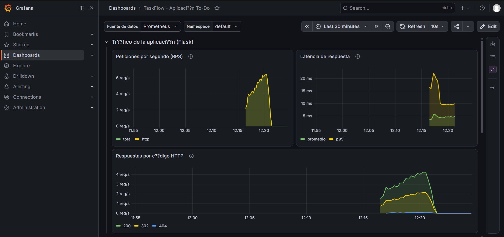

# Entregable 4 — Trabajo integrador DevOps / DevSecOps

Aplicación **TaskFlow** (lista de tareas) llevada a un ciclo completo DevOps y DevSecOps: contenedores, despliegue en Kubernetes con Helm, CI/CD en Jenkins, monitoreo con Prometheus y Grafana, y controles de seguridad automatizados (Semgrep, Snyk, Kyverno y Falco).

---

## Índice

1. [Descripción general del proyecto](#1-descripción-general-del-proyecto)
2. [Arquitectura final](#2-arquitectura-final)
3. [Guía paso a paso (cómo levantar todo)](#3-guía-paso-a-paso)
4. [Contenerización (Docker)](#4-contenerización-docker)
5. [Orquestación y despliegue (Kubernetes + Helm)](#5-orquestación-y-despliegue-kubernetes--helm)
6. [Pipeline CI/CD (Jenkins)](#6-pipeline-cicd-jenkins)
7. [Métricas y dashboard de Grafana](#7-métricas-y-dashboard-de-grafana)
8. [Resultados de seguridad](#8-resultados-de-seguridad)
9. [Problemas encontrados y soluciones](#9-problemas-encontrados-y-soluciones)
10. [Conclusiones y oportunidades de mejora](#10-conclusiones-y-oportunidades-de-mejora)

---

## 1. Descripción general del proyecto

TaskFlow permite crear tareas con prioridad (baja, media, alta), marcarlas como completadas, eliminarlas y filtrarlas. El sistema tiene **dos componentes**:

| Componente       | Tecnología                         | Función                                                                                                                                         |
| ---------------- | ---------------------------------- | ----------------------------------------------------------------------------------------------------------------------------------------------- |
| **todo-app**     | Python 3.15 + Flask                | Aplicación web. Renderiza el HTML, gestiona las tareas, tiene protección CSRF y expone métricas en `/metrics`.                                  |
| **todo-monitor** | Java 21 + Spring Boot + Micrometer | Servicio auxiliar. Recibe un aviso por cada operación (crear, completar, borrar) y lo expone como métrica de negocio en `/actuator/prometheus`. |

Partimos del proyecto de los entregables anteriores (blue/green del entregable 1, monitor y Prometheus/Grafana del entregable 2, controles de seguridad del entregable 3) y lo mejoramos en arquitectura, seguridad, despliegue y monitoreo.

**Herramientas utilizadas:** Docker, Kubernetes (Minikube), Helm, Jenkins, Prometheus, Grafana, Snyk, Semgrep, Kyverno, Falco y Dive.

### Estructura del repositorio

```
.
├── app.py, monitor_client.py, templates/   # Aplicación Flask
├── monitor/                                # Servicio monitor (Spring Boot) + su Dockerfile
├── Dockerfile                              # Imagen de Flask
├── tests/                                  # Tests (pytest)
├── helm-chart/                             # Helm chart del proyecto (Flask + monitor)
├── monitoring/                             # Valores de kube-prometheus-stack
├── grafana/dashboard.json                  # Dashboard exportado de Grafana
├── k8s/policies/                           # 4 políticas de Kyverno
├── k8s/noncompliant-pod.yaml               # Pod de prueba que viola las políticas
├── k8s/falco-shell-test.yaml               # Pod de prueba para Falco
├── jenkins/                                # Imagen de Jenkins con las herramientas del pipeline
├── Jenkinsfile                             # Pipeline CI/CD
├── .snyk, monitor/.snyk                    # Vulnerabilidades aceptadas (documentadas)
├── scripts/                                # setup, teardown, carga, Jenkins, port-forward, Falco
└── reports/                                # Reportes de todas las herramientas + capturas
```

---

## 2. Arquitectura final



**Flujo de una petición:** navegador → Ingress (NGINX, proxy reverso) → Service `todo-app` → pod de Flask. Cuando el usuario crea, completa o borra una tarea, Flask avisa al monitor por su Service interno. Prometheus scrapea las métricas de ambos y Grafana las muestra.

**Seguridad en capas:**

1. **En el código:** Semgrep (análisis estático) y protección CSRF.
2. **En las dependencias y las imágenes:** Snyk.
3. **Al desplegar:** Kyverno rechaza pods que no cumplan las políticas.
4. **En ejecución:** Falco detecta comportamiento sospechoso.

---

## 3. Guía paso a paso

### Requisitos

Docker Desktop, Minikube, kubectl, Helm, Git Bash (en Windows) y una cuenta de Docker Hub y de Snyk (para Jenkins).

### Scripts

| Script                     | Qué hace                                                                                                                                                    |
| -------------------------- | ----------------------------------------------------------------------------------------------------------------------------------------------------------- |
| `scripts/setup.sh`         | Levanta **todo**: Minikube, Ingress, los operadores (Prometheus Operator, Kyverno y Falco), las 4 políticas, el dashboard y la aplicación desde Docker Hub. |
| `scripts/start-jenkins.sh` | Construye y levanta Jenkins (con todas las herramientas) conectado a Minikube.                                                                              |
| `scripts/port-forward.sh`  | Abre los accesos a la app (`todo.local:8082`), Grafana (`localhost:3000`) y Prometheus (`localhost:9090`).                                                  |
| `scripts/load.sh`          | Genera tráfico contra la app para poblar los dashboards (maneja el token CSRF).                                                                             |
| `scripts/falco-demo.sh`    | Dispara la alerta de Falco y la guarda en `reports/falco-event.log`.                                                                                        |
| `scripts/teardown.sh`      | Borra todos los recursos. Con `--all` también borra Jenkins y el cluster.                                                                                   |

### Paso a paso

```bash
# 1. Levantar todo el entorno (cluster + operadores + políticas + app)
GRAFANA_PASSWORD=miClave ./scripts/setup.sh

# 2. Hosts: agregar "127.0.0.1 todo.local" al archivo hosts
#    (Windows, PowerShell como administrador):
#    Add-Content -Path C:\Windows\System32\drivers\etc\hosts -Value "`n127.0.0.1 todo.local"

# 3. Abrir los accesos (dejar corriendo en otra terminal)
./scripts/port-forward.sh

# 4. Generar tráfico y ver el dashboard en Grafana
./scripts/load.sh 300

# 5. Jenkins (CI/CD)
./scripts/start-jenkins.sh

# 6. Demostración de Falco
./scripts/falco-demo.sh

# 7. Borrar todo
./scripts/teardown.sh          # o --all para borrar también Jenkins y Minikube
```

---

## 4. Contenerización (Docker)

Cada componente tiene su propio Dockerfile: `Dockerfile` (Flask) y `monitor/Dockerfile` (Spring Boot). Prometheus, Grafana, Jenkins, etc. son herramientas de infraestructura y usan sus imágenes oficiales.

| Requisito                        | todo-app                      | todo-monitor                                                                   |
| -------------------------------- | ----------------------------- | ------------------------------------------------------------------------------ |
| Versión específica (no `latest`) | `python:3.15.2-slim-bookworm` | `maven:3.9.9-eclipse-temurin-21` → `eclipse-temurin:21.0.13_9-jre-alpine-3.23` |
| Usuario no root                  | `appuser` (UID/GID 10001)     | `appuser` (UID/GID 10001)                                                      |
| Multi-stage                      | `builder` (pip) → runtime     | `build` (Maven + JDK) → runtime (solo JRE)                                     |

```bash
docker build -t todo-app:1.0.2 .
docker build -t todo-monitor:1.0.2 ./monitor
docker run --rm todo-app:1.0.2 whoami                 # appuser
docker run --rm --entrypoint id todo-monitor:1.0.2    # uid=10001(appuser)
```

**Validación de calidad:** Snyk (vulnerabilidades) y Dive (capas y tamaño). Detalle completo en **[`reports/image-analysis.md`](reports/image-analysis.md)**.

| Imagen       | Tamaño (Dive)       | Capas | Eficiencia | Vulnerabilidades (antes → después) |
| ------------ | ------------------- | ----- | ---------- | ---------------------------------- |
| todo-app     | 128 MB → 130 MB     | 9     | 97 %       | **267 → 127** (críticas 7 → 1)     |
| todo-monitor | 314 MB → **236 MB** | 8     | 99 %       | **447 → 18** (críticas 18 → 1)     |

**Correcciones aplicadas:**

- Flask: se actualizó la imagen base (era de hace dos años).
- Monitor: se pasó de Ubuntu a Alpine con JRE actualizado, se actualizó Spring Boot y se forzaron versiones parcheadas de Tomcat, Jackson y otras librerías en el `pom.xml`.

Capturas de Dive: `reports/dive-1.0.0.png`, `reports/dive-1.0.1.png`, `reports/dive-monitor-1.0.0.png`, `reports/dive-monitor-1.0.2.png`.

---

## 5. Orquestación y despliegue (Kubernetes + Helm)

La chart `helm-chart/` despliega **los dos componentes** con un solo comando:

| Template                                           | Recurso                          | Función                                                                         |
| -------------------------------------------------- | -------------------------------- | ------------------------------------------------------------------------------- |
| `deployment.yaml`                                  | Deployment Flask                 | Pods de la app con recursos, seguridad y probes (`/healthz`)                    |
| `service.yaml`                                     | Service Flask                    | Punto de acceso estable, puerto 80 → 5000                                       |
| `configmap.yaml`                                   | ConfigMap                        | Configuración: versión mostrada, URL del monitor                                |
| `secret.yaml`                                      | Secret                           | Clave de Flask para firmar sesiones y tokens CSRF (igual en todas las réplicas) |
| `ingress.yaml`                                     | Ingress                          | Entrada HTTP desde afuera: `todo.local` → Service                               |
| `monitor-deployment.yaml` / `monitor-service.yaml` | Deployment + Service del monitor | Servicio auxiliar, **solo interno** (sin Ingress)                               |
| `servicemonitor.yaml`                              | ServiceMonitor                   | Le dice a Prometheus qué scrapear                                               |
| `prometheusrule.yaml`                              | PrometheusRule                   | Alertas (creaciones excesivas, latencia alta)                                   |

**Parámetros configurables** (`values.yaml`): imagen y tag, réplicas, puertos, recursos, seguridad, probes, ingress, monitor y métricas.

**Valores por entorno:**

|                | `values-dev.yaml` | `values-prod.yaml`      |
| -------------- | ----------------- | ----------------------- |
| Réplicas       | 1                 | 3 (alta disponibilidad) |
| Recursos       | Menores           | Mayores                 |
| Página muestra | `1.0.X (dev)`     | `1.0.X (prod)`          |

```bash
helm lint ./helm-chart
helm install todo-app ./helm-chart -f helm-chart/values-dev.yaml
kubectl get pods,svc,ingress,configmap
helm upgrade todo-app ./helm-chart -f helm-chart/values-prod.yaml   # pasa a 3 réplicas
helm rollback todo-app 2                                           # vuelve a la revisión anterior
```

**Verificación:** pods en `1/1 Running`, y la app accesible por el Ingress (`http://todo.local:8082`).




**Seguridad de los pods** (los dos componentes): usuario no root (10001), sin escalada de privilegios, sistema de archivos de solo lectura, todas las capabilities de Linux eliminadas y perfil seccomp por defecto.

---

## 6. Pipeline CI/CD (Jenkins)

Jenkins corre en Docker con una **imagen propia** (`jenkins/Dockerfile`) que trae todas las herramientas con versiones fijas: Semgrep, Snyk, Docker CLI, kubectl, Helm, Python y Maven. Se conecta al Docker de la máquina (para construir imágenes) y a la red de Minikube (para desplegar).

**Etapas del `Jenkinsfile`:**

| #   | Etapa                                | Herramienta                                | Corta el pipeline si…                                  |
| --- | ------------------------------------ | ------------------------------------------ | ------------------------------------------------------ |
| 1   | Clonar repositorio                   | Git                                        | —                                                      |
| 2   | Análisis estático                    | **Semgrep** (`p/python`, `p/flask`)        | hay hallazgos                                          |
| 3   | Dependencias                         | **Snyk** (`requirements.txt` y `pom.xml`)  | hay una vulnerabilidad **crítica** nueva               |
| 4   | Build & Test                         | **pytest** (13 tests) + Maven              | falla un test                                          |
| 5   | Docker: build, escaneo y publicación | Docker + **Snyk Container** + Docker Hub   | una imagen tiene una crítica nueva (**no se publica**) |
| 6   | Deploy                               | **Helm** (`helm upgrade --install --wait`) | los pods no arrancan                                   |

- **Versionado:** cada ejecución publica `juanalopez1/todo-app:1.0.<build>` y `juanalopez1/todo-monitor:1.0.<build>`.
- **Secretos:** el token de Docker Hub, el de Snyk y el kubeconfig se guardan como **credenciales de Jenkins**; en los logs aparecen como `****`.
- **Registros:** cada build archiva los reportes de Semgrep, Snyk y pytest.
- **Parámetros:** `DEPLOY_TARGET` (`minikube` o `ucu`) y `ENVIRONMENT` (`dev` o `prod`).

**Corte ante vulnerabilidades críticas (3.e):** en la ejecución #1, Snyk detectó una vulnerabilidad crítica en la imagen de Flask. El pipeline se detuvo en la etapa 5, la imagen **no se publicó** y el deploy se salteó.



Las vulnerabilidades críticas analizadas y aceptadas están documentadas en `.snyk` y `monitor/.snyk`, con su motivo y una **fecha de vencimiento** (febrero de 2027): al vencer, el pipeline vuelve a fallar y obliga a revisarlas. Cualquier otra crítica nueva corta el pipeline.

**Ejecución exitosa** (las 6 etapas en verde) e imágenes publicadas y desplegadas:





---

## 7. Métricas y dashboard de Grafana

### Instrumentación

| Componente | Librería                     | Endpoint               | Métricas                                                                                                                       |
| ---------- | ---------------------------- | ---------------------- | ------------------------------------------------------------------------------------------------------------------------------ |
| Flask      | `prometheus_client`          | `/metrics`             | `http_requests_total`, `http_request_duration_seconds` (histograma), `todo_tasks_created_total{priority}`, `todo_tasks{state}` |
| Monitor    | Micrometer + Spring Actuator | `/actuator/prometheus` | `todo_operations_total{operation, priority, version}`                                                                          |

- `/metrics` y `/healthz` no se cuentan como tráfico, para no inflar el RPS.
- Las rutas se registran como plantilla (`/complete/<int:task_id>`) para no generar una serie de métricas por cada tarea.

### Prometheus y Grafana

Se instalaron con el chart oficial **kube-prometheus-stack** (versión 87.19.2), que incluye el **Prometheus Operator**, Prometheus, Grafana, Alertmanager, node-exporter y kube-state-metrics. Configuración: `monitoring/kube-prometheus-stack-values.yaml`.

- **Scrape:** la chart de la app crea dos **ServiceMonitor** (Flask y monitor). Prometheus los descubre solo.
- **CPU y memoria por pod:** vienen de cAdvisor (kubelet) y kube-state-metrics.
- **Grafana:** viene conectado a Prometheus como fuente de datos. El dashboard se carga automáticamente desde un ConfigMap con la etiqueta `grafana_dashboard=1`.
- **Alertas:** `TooManyTaskCreations`, `TooManyHighPriorityCreations` (del entregable 2) y `HighLatency`.



### Dashboard: "TaskFlow - Aplicación To-Do"

Exportado en **[`grafana/dashboard.json`](grafana/dashboard.json)**.

| Sección  | Panel                                        | Consulta (PromQL)                                                                                       |
| -------- | -------------------------------------------- | ------------------------------------------------------------------------------------------------------- |
| Tráfico  | **Peticiones por segundo (RPS)**             | `sum(rate(http_requests_total[1m]))`                                                                    |
| Tráfico  | **Latencia promedio** y p95                  | `sum(rate(http_request_duration_seconds_sum[1m])) / sum(rate(http_request_duration_seconds_count[1m]))` |
| Tráfico  | Respuestas por código HTTP                   | `sum by (status) (rate(http_requests_total[1m]))`                                                       |
| Recursos | **CPU por pod**                              | `sum by (pod) (rate(container_cpu_usage_seconds_total{pod=~"todo-app.*"}[2m]))`                         |
| Recursos | **Memoria por pod**                          | `sum by (pod) (container_memory_working_set_bytes{pod=~"todo-app.*"})`                                  |
| Negocio  | **Tareas actuales** (pendientes/completadas) | `sum by (state) (todo_tasks)`                                                                           |
| Negocio  | **Tareas creadas por prioridad**             | `sum by (priority) (increase(todo_tasks_created_total[5m]))`                                            |
| Negocio  | Operaciones por tipo (monitor)               | `sum by (operation) (increase(todo_operations_total[5m]))`                                              |

Tráfico generado con `./scripts/load.sh 300`:



---

## 8. Resultados de seguridad

### 8.1 Semgrep (análisis estático) — `reports/semgrep-report.txt`

- **Reglas:** `p/python` y `p/flask`, del registro de Semgrep (151 reglas de seguridad para Python y Flask).
- **Alcance:** `app.py`, `monitor_client.py` y `tests/test_app.py`. Corre en cada ejecución del pipeline.
- **Resultado actual: 0 hallazgos.** Los hallazgos de iteraciones anteriores se corrigieron o justificaron:
  - **Falta de protección CSRF en formularios →** corregido con Flask-WTF (`CSRFProtect`) y token en cada formulario. Hay un test que verifica que un POST sin token es rechazado.
  - **`app.run(host="0.0.0.0")` →** justificado: el contenedor necesita escuchar en todas sus interfaces para recibir tráfico. La exposición real la controlan Kubernetes (Service `ClusterIP`) y el Ingress. Se marcó con un comentario `nosemgrep` con la justificación.

### 8.2 Snyk (dependencias) — `reports/snyk-report.txt`

Corre en la etapa 3 del pipeline sobre `requirements.txt` (Flask) y `monitor/pom.xml` (Spring Boot), y corta ante vulnerabilidades críticas.

| Componente                                        | Resultado                                                   | Críticas     |
| ------------------------------------------------- | ----------------------------------------------------------- | ------------ |
| Flask (`Flask`, `Flask-WTF`, `prometheus-client`) | Sin vulnerabilidades críticas                               | 0            |
| Monitor (Spring Boot 3.5.15 + versiones forzadas) | 17 vulnerabilidades (1 crítica, 8 altas, 6 medias, 2 bajas) | 1 (aceptada) |

**Vulnerabilidad crítica identificada y corrección propuesta:**

| Vulnerabilidad                                                   | Librería               | Corrección propuesta                                | Estado                                                               |
| ---------------------------------------------------------------- | ---------------------- | --------------------------------------------------- | -------------------------------------------------------------------- |
| Arbitrary Code Injection (SNYK-JAVA-ORGSPRINGFRAMEWORK-19267098) | `spring-webmvc` 6.2.19 | Migrar a **Spring Boot 4 / Spring Framework 7.0.9** | Aceptada temporalmente en `monitor/.snyk` (vence en febrero de 2027) |

- **Por qué no se aplicó ya:** Spring Boot 4 es un cambio de versión mayor, con cambios incompatibles en el código.
- **Mitigación:** el monitor no tiene Ingress (Service `ClusterIP`, solo lo usan Flask y Prometheus), corre como no root y con sistema de archivos de solo lectura.
- **Correcciones ya aplicadas en el monitor:** de 128 vulnerabilidades (15 críticas) con Spring Boot 3.4.5 se bajó a 17 (1 crítica), subiendo a Spring Boot 3.5.15 y forzando versiones parcheadas de Tomcat (10.1.61), Jackson (2.21.8), Logback (1.5.36), Log4j (2.25.5) e Hibernate Validator (8.0.6).
- **Otras correcciones propuestas:** Micrometer 1.16.7 (2 altas) y Logback 1.6.5 (2 medias), cuando Spring Boot las soporte oficialmente.
- **Vulnerabilidad detectada por el pipeline (build #5):** el 17/11/2026 Snyk publicó una vulnerabilidad crítica de ejecución remota de código en el JRE de Java (`SNYK-UPSTREAM-OPENJDKJRE-22576909`, `openjdk-jre 21.0.13`). La imagen del monitor no había cambiado respecto al build anterior, que pasó: el pipeline detectó una vulnerabilidad **nueva** y bloqueó la publicación y el despliegue. Todavía no existe una versión corregida (Snyk indica que ya usamos la imagen base más segura), por lo que se documentó en `monitor/.snyk` con vencimiento de un mes (17/12/2026) y las mitigaciones ya aplicadas (sin Ingress, no root, solo lectura). Al publicarse el parche, la corrección es actualizar la imagen base del monitor.

### 8.3 Kyverno (políticas) — `reports/kyverno-validation.log`

Kyverno se instala como operador (chart oficial 3.9.2). Revisa cada pod **antes de crearlo** y rechaza los que no cumplen.

| #   | Política                           | Qué exige                                                                                                                                             |
| --- | ---------------------------------- | ----------------------------------------------------------------------------------------------------------------------------------------------------- |
| 1   | `disallow-latest-tag`              | Imágenes con versión fija, nunca `latest` (sin excepciones)                                                                                           |
| 2   | `require-container-resources`      | `requests` y `limits` de CPU y memoria en todos los contenedores                                                                                      |
| 3   | `disallow-root-containers`         | `runAsNonRoot: true` y UID mayor a 0                                                                                                                  |
| 4   | `require-readonly-root-filesystem` | **(buena práctica adicional)** `readOnlyRootFilesystem: true`: si comprometen un contenedor, no puede modificar sus archivos ni instalar herramientas |

- **Validación:** el pod de prueba `k8s/noncompliant-pod.yaml` (que usa `latest`, corre como root, no tiene límites y puede escribir en su disco) fue **rechazado por las 4 políticas a la vez**, y se comprobó que no se creó.
- **Prueba positiva:** se reiniciaron los pods de la app (`kubectl rollout restart`) y fueron aceptados. La app cumple las 4 políticas.
- **Excepciones:** las políticas 2, 3 y 4 excluyen los namespaces de infraestructura (`falco`, `monitoring`, `ingress-nginx`, `kyverno`, `kube-system`), que son charts oficiales y necesitan permisos especiales (acceso al nodo, escritura en disco). La política de `latest` no tiene excepciones.

### 8.4 Falco (seguridad en ejecución) — `reports/falco-event.log`

Falco se instala con su chart oficial (driver `modern_ebpf`). Vigila las llamadas al sistema de los contenedores mientras corren.

- **Acción disparada (sin abrir una shell):** desde un pod de prueba se ejecutó `wget` hacia el **API Server de Kubernetes**:
  ```bash
  kubectl exec falco-shell-test -- wget -T 5 --no-check-certificate -qO- https://kubernetes.default.svc/version
  ```
- **Alerta:** `Notice Unexpected connection to K8s API Server from container`, con el proceso (`wget`), el usuario (UID 10001), el pod, la imagen y la conexión (`10.96.0.1:443`).
- **Por qué es relevante:** es lo que haría un atacante después de comprometer un contenedor: explorar el cluster a través de su API. Una aplicación web normal no tiene motivo para conectarse al API Server.

Se reproduce con `./scripts/falco-demo.sh`.

---

## 9. Problemas encontrados y soluciones

| Problema                                                                                             | Solución                                                                                           |
| ---------------------------------------------------------------------------------------------------- | -------------------------------------------------------------------------------------------------- |
| Imagen base de Flask con 267 vulnerabilidades (7 críticas)                                           | Actualización a `python:3.15.2-slim-bookworm` (−52 %)                                              |
| Monitor con 447 vulnerabilidades y corriendo como root                                               | Alpine + JRE actualizado, usuario no root, Spring Boot 3.5 y versiones parcheadas (−96 %)          |
| Dive v0.12.0 no lee las imágenes de Docker Desktop (`could not find blobs`)                          | Uso de Dive v0.13.1                                                                                |
| `docker image ls` y Dive informan tamaños distintos                                                  | Docker Desktop (containerd) suma también los datos comprimidos; se usa el tamaño de Dive           |
| El puerto 80 de Windows estaba ocupado por IIS, así que `minikube tunnel` no exponía el Ingress      | Port-forward al Ingress Controller en el puerto 8082                                               |
| Puertos 5000 y 8080 ocupados por contenedores anteriores                                             | Uso de otros puertos (8081-8085, 8090 para Jenkins)                                                |
| El monitor solo aceptaba las versiones `blue` y `green` (del entregable 1) y rechazaba los avisos    | Se cambió la validación por un formato de versión, y Flask envía el tag de la imagen               |
| `monitor_client.py` importaba `TimeoutError` y `OSError` desde `urllib.error`, y la app no arrancaba | Corrección del import                                                                              |
| Con CSRF y varias réplicas, cada pod generaba su propia clave y los formularios fallaban entre pods  | Clave compartida en un Secret de Kubernetes                                                        |
| Kyverno exige `runAsNonRoot` a nivel de contenedor; la chart solo lo tenía a nivel de pod            | Se agregó también al `securityContext` del contenedor                                              |
| Las políticas de Kyverno bloquearían los pods de monitoreo e Ingress al reiniciarse                  | Exclusión de los namespaces de infraestructura                                                     |
| El pipeline se cortaba por críticas sin parche disponible, ya analizadas                             | Archivos `.snyk` con justificación y fecha de vencimiento                                          |
| Git Bash convierte rutas `/var/...` en rutas de Windows                                              | `MSYS_NO_PATHCONV=1` en los scripts                                                                |
| Prometheus del entregable 2 (yaml manuales) no medía CPU ni memoria por pod                          | Reemplazo por kube-prometheus-stack (Prometheus Operator) y ServiceMonitors                        |
| Conflictos al unir las ramas de los entregables 2 y 3 (Dockerfiles duplicados, blue/green)           | Unificación en un Dockerfile por componente; el entregable 1 quedó en el tag de git `entregable-1` |
| Vulnerabilidad crítica nueva en el JRE (publicada el mismo día) frenó el pipeline                    | Se analizó, se confirmó que no hay parche y se documentó en `monitor/.snyk` con vencimiento corto  |

---

## 10. Conclusiones y oportunidades de mejora

**Conclusiones:**

- El proyecto quedó con un flujo completo y automatizado: un `git push` dispara análisis de código, de dependencias y de imágenes, tests, publicación versionada y despliegue con Helm.
- La seguridad se aplica en **cada etapa**: en el código (Semgrep, CSRF), en las dependencias y las imágenes (Snyk), al desplegar (Kyverno) y en ejecución (Falco). Una vulnerabilidad crítica nueva frena el pipeline antes de que la imagen llegue al cluster.
- Los análisis mostraron que la mayor parte del riesgo venía de **imágenes base y dependencias desactualizadas**, no del código propio. Actualizarlas redujo las vulnerabilidades un 52 % en Flask y un 96 % en el monitor.
- La observabilidad permite ver en tiempo real el tráfico, la latencia, el consumo de recursos y métricas de negocio, con alertas automáticas.

**Oportunidades de mejora:**

1. **Persistencia:** las tareas se guardan en memoria, así que con varias réplicas cada pod tiene su propia lista y se pierden al reiniciar. Agregar una base de datos o Redis.
2. **Servidor de producción:** reemplazar el servidor de desarrollo de Flask por Gunicorn.
3. **Migraciones pendientes:** Spring Boot 4 en el monitor y Debian 13 en Flask, para eliminar las vulnerabilidades críticas aceptadas.
4. **Imágenes más chicas:** JRE reducido con `jlink` (monitor) o imágenes _distroless_.
5. **Jenkins:** construir imágenes sin acceso al socket de Docker (por ejemplo, con Kaniko) y disparar el pipeline automáticamente con un webhook de GitHub.
6. **HTTPS** en el Ingress (cert-manager) y envío de las alertas de Falco y Alertmanager a un canal (Slack o correo).
7. **Kyverno:** migrar las políticas al nuevo formato `ValidatingPolicy` (CEL), ya que `ClusterPolicy` está marcado como obsoleto.
